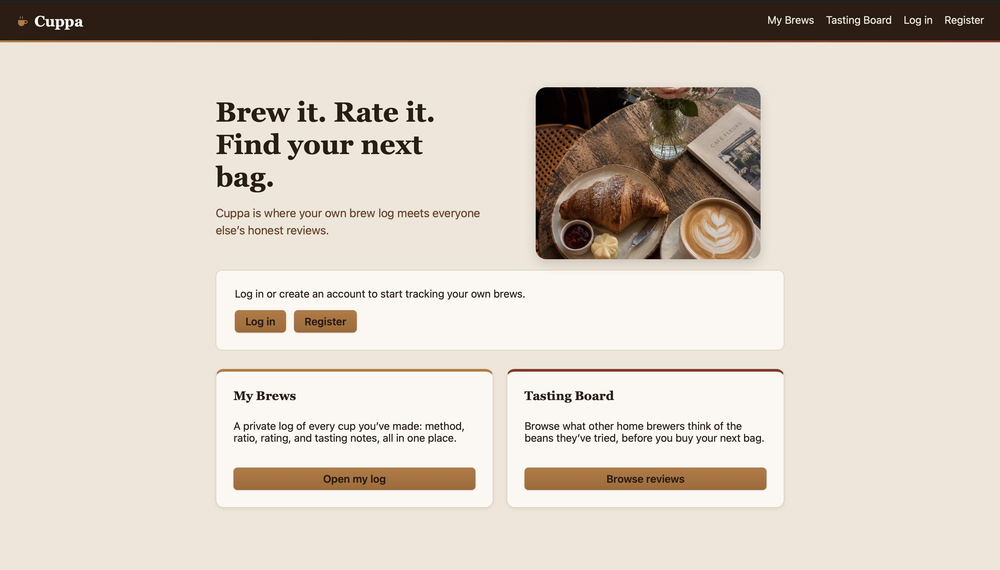
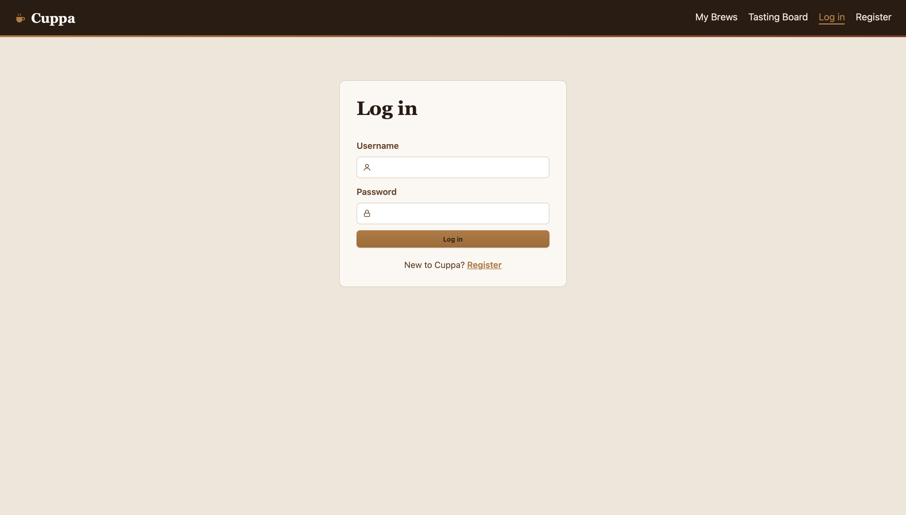
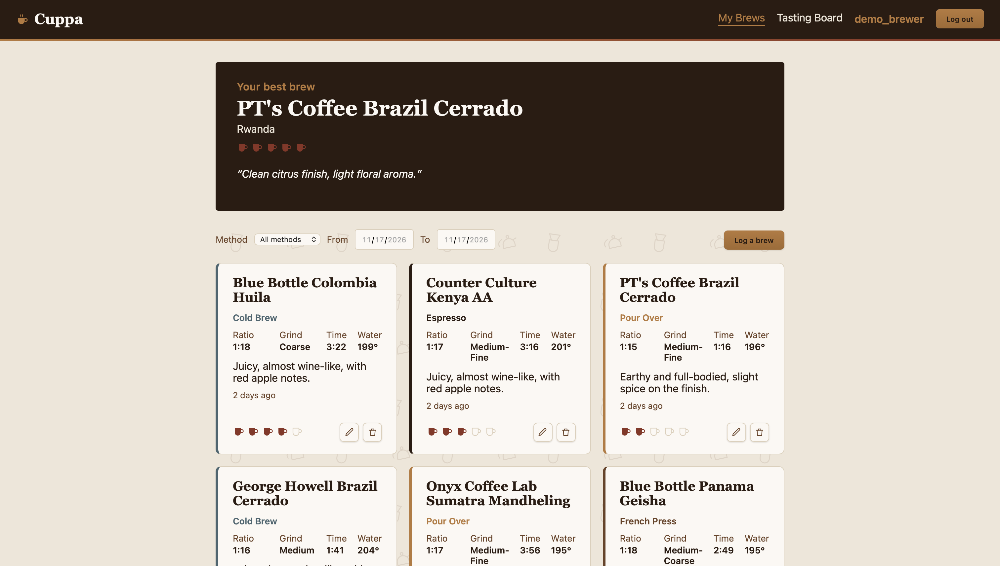
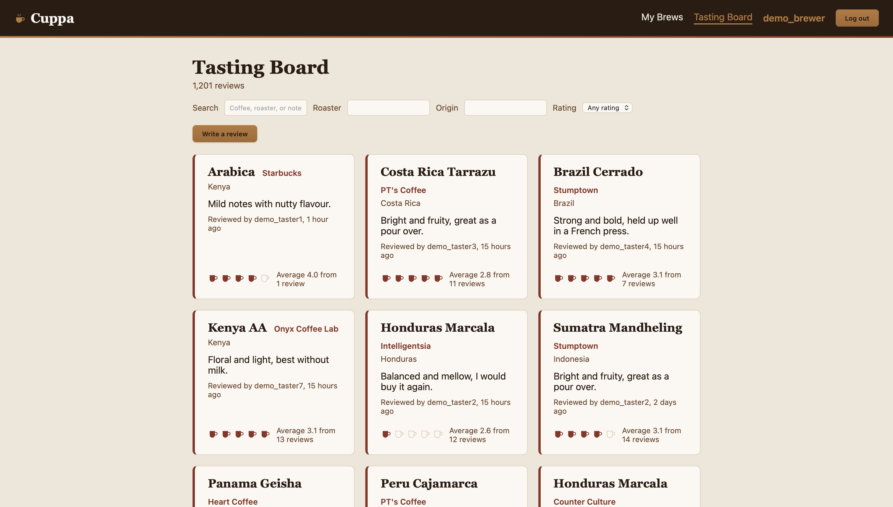

# Design Document - Cuppa

- **Authors** Sai Venkatesh Varun Muruganandam Murali Krishnan, Sree Rachnae Shyam
- **Class** [CS5610 Web Development, Fall 2026](https://johnguerra.co/classes/webDevelopment_online_fall_2026/)
- **Website** (add the Render link here)

## Project Description

Cuppa is a coffee app. It helps home brewers repeat their best cup and find beans worth buying. Most people who brew at home change the beans, grind, ratio and water temperature without writing anything down, so a great cup is hard to make again. Buying new beans is also a guess, because reviews are spread across store pages and forums. Cuppa keeps your own brews and other people's bean reviews in one place.

The app has two sides:
- The **Brew Log** is private. A logged-in user records each brew with its settings and rating, filters their history, and sees their best-rated brew at the top.
- The **Tasting Board** is public. Anyone can browse and filter bean reviews and see each coffee's average rating. Logged-in users can post reviews and edit or delete their own.

We built one side each. Rachna built the Brew Log and the login, and Varun built the Tasting Board.

The app has a home page and four feature pages:
- **Home** (/) explains what Cuppa is, shows your best brew when you are logged in, and links to both features.
- **Log in** (/login) and **Register** (/register) let a user sign in or create an account.
- **My Brews** (/brews) is where a logged-in user logs, edits, deletes and filters their brews.
- **Tasting Board** (/tastings) is where anyone browses reviews, and logged-in users write, edit and delete their own.

## User Personas

### Persona 1: Maya, Home Brewer
Maya is a grad student who brews coffee at home every morning. She wants to remember what made her best cup so she can make it again.

### Persona 2: Leo, Coffee Buyer
Leo is a coffee fan who buys a new bag of beans every couple of weeks. He wants to read honest reviews before he spends money on a coffee.

## User Stories

### User Story 1: Maya, Account
As Maya, I want to register, log in and log out, so my brews stay private.

Requirements for Acceptance:
- A user registers with a username and password, and is logged in right away
- Passwords are hashed, never stored as plain text
- The login stays active after a page refresh
- My Brews can only be opened when logged in, and a user only ever sees their own brews

### User Story 2: Maya, Brews
As Maya, I want to create, edit and delete brews, so I can keep a record of every cup.

Requirements for Acceptance:
- A brew has a bean or roaster, origin, method, grind size, ratio, brew time, water temperature, rating, date and tasting notes
- Bean or roaster, method, rating and date are required
- The method is one of Pour Over, French Press, Espresso, AeroPress, Cold Brew or Other
- The rating is set by clicking 1 to 5 coffee cups
- Brews can be edited or deleted, and deleting asks for confirmation

### User Story 3: Maya, Filters and Best Brew
As Maya, I want to filter my brews and see my best-rated one, so I can repeat my best cup.

Requirements for Acceptance:
- Brews can be filtered by method and by a From and To date
- A banner at the top shows the highest-rated brew with its settings
- The banner updates right after a brew is saved or deleted

### User Story 4: Leo, Reviews
As Leo, I want to create, edit and delete my own reviews, so I can share what I think of a coffee.

Requirements for Acceptance:
- A review has a coffee name, roaster, origin, rating and tasting notes
- Coffee name, roaster and rating are required, and the rating is a whole number from 1 to 5
- Only logged-in users can post a review
- Edit and Delete only show on the user's own reviews, and the server rejects changes to anyone else's
- Deleting a review asks for confirmation

### User Story 5: Leo, Browse and Filter
As Leo, I want to browse and filter reviews by roaster, origin and rating, so I can find the coffees I care about.

Requirements for Acceptance:
- Anyone can open the Tasting Board without logging in
- Reviews can be filtered by roaster and origin (partial match, not case sensitive) and by a minimum rating
- The filters can be combined, and the list updates as the user types
- Newest reviews show first

### User Story 6: Leo, Average Rating
As Leo, I want to see each coffee's average rating, so one review does not decide my purchase.

Requirements for Acceptance:
- Each review card shows the average rating and the number of reviews for that coffee
- The average groups reviews by coffee name and roaster together, since the same coffee from two roasters is a different product
- The average updates after a review is posted, edited or deleted

## Design Mockups

These are screenshots of the finished pages.

### Home page

This is the home page. It has the navigation bar, a short introduction, and two cards that link to My Brews and the Tasting Board. A logged-out visitor sees Log in and Register buttons, and a logged-in user sees their best brew instead.

### Log in and Register pages

This is the Log in page. It has a username field, a password field and a Log in button. The Register page uses the same form with a Register button.

### My Brews page

This is the My Brews page. The best brew banner sits at the top. Under it are the method and date filters and a Log a brew button that opens the brew form. Each brew card shows the bean, method, settings, notes, date and cup rating, with Edit and Delete buttons.

### Tasting Board page

This is the Tasting Board page. It has the roaster, origin and rating filters at the top. A logged-out visitor sees a note to log in, and a logged-in user sees a Write a review button that opens the review form. Each review card shows the coffee, roaster, origin, notes, reviewer and date, the cup rating, and the coffee's average rating. The user's own reviews also have Edit and Delete buttons.
