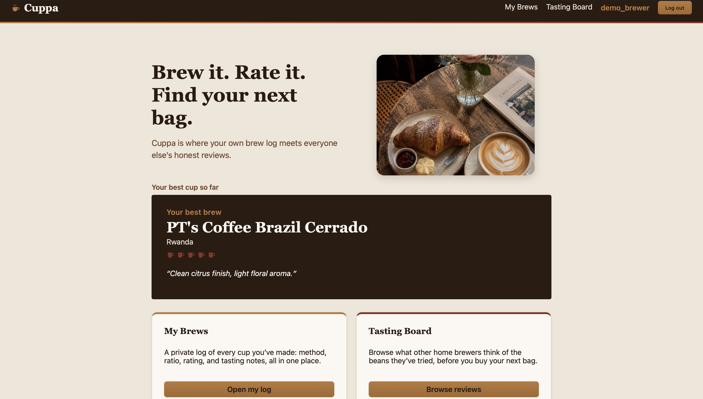

# Cuppa - Coffee Brew Log & Tasting Board

Cuppa helps home brewers improve their coffee and find beans worth buying.
It has two independent features: a private **Brew Log** and a public
**Tasting Board**.

## Author

- Sree Rachnae Shyam
- Sai Venkatesh Varun Muruganandam Murali Krishnan

## Class Link

[CS5610 Web Development](https://johnguerra.co/classes/webDevelopment_online_fall_2026/)

## Project Objective

Help two kinds of coffee drinkers:

- **Maya** brews at home and wants to repeat her best cup, so she keeps a
  private **Brew Log** of every brew and its rating (Rachna's feature).
- **Leo** wants honest reviews before buying beans, so he browses the
  public **Tasting Board**, filters reviews by roaster, origin and rating,
  and sees each coffee's average rating (Varun's feature).

## Live Demo

https://cuppa-o57w.onrender.com

Demo logins (seeded data): `demo_brewer` / `demo12345` for the Brew Log,
`demo_taster1` to `demo_taster8` / `demo12345` for the Tasting Board.

## Screenshot



## How to Use

1. Open the **Tasting Board** from the nav bar. Anyone can browse it
   without logging in.
2. Filter by roaster, origin, or minimum rating. Each card shows the
   coffee's average rating across all reviews.
3. **Register** or **Log in** to write a review, or to log your own brews
   in the **Brew Log**.
4. Your own reviews and brews show **Edit** and **Delete** buttons.

---

## Tech Stack

- **Frontend:** React 18 (with Hooks), built with Vite, React Router,
  PropTypes, Fetch API
- **Backend:** Node.js, Express (ES modules)
- **Authentication:** Passport (local strategy), `express-session`,
  sessions stored in MongoDB via `connect-mongo`, passwords hashed with
  `bcryptjs`
- **Database:** MongoDB, native Node.js driver (no Mongoose)
- Separate `package.json` files for `backend/` and `frontend/`
- No Axios and no CORS package, since Express serves the built React app
  directly

---

## Setup / Instructions to Build

### Backend

```
cd backend
npm install
```

Create a `.env` file in `backend/` (never committed):

```
MONGODB_URI=mongodb+srv://<user>:<password>@<cluster>/cuppa?retryWrites=true&w=majority
SESSION_SECRET=<any long random string>
```

Run it:

```
node --env-file=.env server.js
```

### Frontend

```
cd frontend
npm install
npm run dev
```

Opens at `http://localhost:5173`, proxying `/api` requests to the backend
on port 3000 during local development.

### Production build (how it runs on Render)

Express serves the built React app from `frontend/dist`, so there is one
server and no CORS:

```
cd frontend && npm install && npm run build
cd ../backend && npm install && node --env-file=.env server.js
```

Then open `http://localhost:3000`. On Render (Web Service, repo root):

- **Build command:** `cd frontend && npm install && npm run build && cd ../backend && npm install`
- **Start command:** `cd backend && npm start`
- **Environment variables:** `MONGODB_URI` and `SESSION_SECRET`, set in
  the Render dashboard, never committed

### Lint and format

```
cd backend  && npm run lint && npm run format
cd frontend && npm run lint && npm run format
```

ESLint configs live in each folder (`eslint.config.js`), and the shared
Prettier config is `.prettierrc.json` at the repo root.

---

## Authentication

Passport local strategy with sessions stored in MongoDB (`connect-mongo`),
so logins persist across server restarts and page refreshes. Passwords
are hashed with `bcryptjs`, so plain text passwords are never stored.

| Endpoint             | Method | Description                                    |
| -------------------- | ------ | ---------------------------------------------- |
| `/api/auth/register` | POST   | Create an account, logs in immediately         |
| `/api/auth/login`    | POST   | Log in                                         |
| `/api/auth/logout`   | POST   | Log out                                        |
| `/api/auth/session`  | GET    | Check whether the current session is logged in |

Every authenticated request has `req.user` available server-side
(`req.user._id`, `req.user.username`).

---

## Brew Log (Rachna's feature)

A private, per-user log of coffee brews. Only the logged-in user can see
or modify their own brews. This is enforced server-side on every route,
not just hidden in the UI.

### Features

- Create, edit, and delete brew entries: bean/roaster, origin, brew
  method, grind size, ratio, brew time, water temperature, rating (1-5),
  tasting notes, and date
- Filter the log by brew method and/or a date range
- A "Best Brew" banner automatically surfaces the single highest-rated
  entry, and updates immediately after any save or delete
- Ratings are shown and entered as coffee-cup icons rather than generic
  stars, with click-to-rate and hover preview in the logging form

### Data model

```text
brews collection
  _id
  userId      string form of the owning user's ObjectId
  beanName    required
  origin      optional
  method      Pour Over, French Press, Espresso, AeroPress, Cold Brew, Other
  grindSize
  ratio       e.g. "1:16"
  brewTime    e.g. "3:30"
  waterTemp   number, °F
  rating      1-5, required
  notes
  date        required
  createdAt
```

### API

All brew routes require login.

| Endpoint                         | Method | Description                                          |
| -------------------------------- | ------ | ---------------------------------------------------- |
| `/api/brews?method=&start=&end=` | GET    | List the logged-in user's brews, optionally filtered |
| `/api/brews/best`                | GET    | The logged-in user's single highest-rated brew       |
| `/api/brews`                     | POST   | Create a brew                                        |
| `/api/brews/:id`                 | PUT    | Update a brew (only if you own it)                   |
| `/api/brews/:id`                 | DELETE | Delete a brew (only if you own it)                   |

### Seed script

```
cd backend
node --env-file=.env scripts/seedBrews.js [count]
```

- Creates a demo account (`demo_brewer` / `demo12345`) if it doesn't
  already exist
- Generates `count` synthetic brews (defaults to 1200 if no count is
  given) for that demo account only
- **Idempotent and safe to re-run.** It only ever clears and replaces
  the demo account's own previously seeded brews, never any other user's
  real data

---

## Tasting Board (Varun's feature)

A public board of coffee bean reviews. Anyone can browse and filter it
without an account. Logging in lets you post reviews, and only a review's
author can edit or delete it (checked server-side, not just hidden in the
UI).

### Features

- Create, edit, and delete your own reviews: coffee name, roaster, origin,
  rating (1-5 coffee cups), and tasting notes
- Browse every review, newest first, and filter by roaster, origin
  (case-insensitive, partial match), and minimum rating
- Each review card shows that coffee's **average rating** and review count
  across all reviews of the same coffee from the same roaster, and it
  updates after any save or delete

### Data model

```text
tastings collection
  _id
  userId       string form of the author's ObjectId (set by the server)
  username     author's username, shown on the card (set by the server)
  coffeeName   required
  roaster      required
  origin       optional
  rating       whole number 1-5, required
  notes        optional
  createdAt
```

The server only saves the fields above, so a client cannot set `userId`
or `username` itself.

### API

| Endpoint                                    | Method | Login | Description                                   |
| ------------------------------------------- | ------ | ----- | --------------------------------------------- |
| `/api/tastings?roaster=&origin=&minRating=` | GET    | No    | List reviews, optionally filtered             |
| `/api/tastings/averages`                    | GET    | No    | Average rating and count per coffee + roaster |
| `/api/tastings`                             | POST   | Yes   | Post a review                                 |
| `/api/tastings/:id`                         | PUT    | Yes   | Edit a review (author only, otherwise 404)    |
| `/api/tastings/:id`                         | DELETE | Yes   | Delete a review (author only, otherwise 404)  |

### Seed script

```
cd backend
node --env-file=.env scripts/seedTastings.js [count]
```

- Creates 8 demo accounts (`demo_taster1` to `demo_taster8` /
  `demo12345`) if they don't already exist
- Generates `count` synthetic reviews (defaults to 1200) spread across
  those accounts, 12 coffees and 8 roasters
- **Idempotent and safe to re-run.** It only clears and replaces reviews
  written by the demo accounts, never real users' reviews

### Frontend files

```
frontend/src/
├── components/
│   ├── TastingCard.jsx / .css       - one review, with its coffee's average
│   ├── TastingFilterBar.jsx / .css  - roaster, origin, and rating filters
│   └── TastingForm.jsx / .css       - create/edit review form
└── pages/
    └── TastingsPage.jsx / .css      - the Tasting Board page itself
```

---

## Frontend structure (Brew Log side)

```
frontend/src/
├── components/
│   ├── BestBrewBanner.jsx   - the hero "best brew" display
│   ├── BrewCard.jsx         - one logged brew, ticket-style
│   ├── BrewFilterBar.jsx    - method + date range filters
│   ├── BrewForm.jsx         - create/edit form
│   ├── CupRating.jsx        - coffee-cup rating, display or interactive
│   ├── NavBar.jsx           - shared nav (used by both features)
│   ├── AuthForm.jsx         - shared login/register form
│   └── ProtectedRoute.jsx   - shared login-required route guard
├── constants/
│   └── brewMethods.js       - method list and method-to-color mapping
├── context/
│   └── AuthContext.jsx      - shared session state
└── pages/
    ├── HomePage.jsx
    ├── LoginPage.jsx
    ├── RegisterPage.jsx
    └── BrewsPage.jsx        - the Brew Log page itself
```

Color palette and shared conventions are documented in `HANDOFF.md`.

---

## Use of GenAI Tools

Used Claude (Anthropic) for planning, debugging, and implementation
assistance on the authentication system, Brew Log feature, UI styling,
and this documentation.

Varun used Claude (Anthropic) on the Tasting Board for help with the
ESLint and Prettier setup, the Express fallback route for deployment,
testing the API, and writing the Tasting Board section of this README.

---

## License

MIT. See [LICENSE](./LICENSE).
