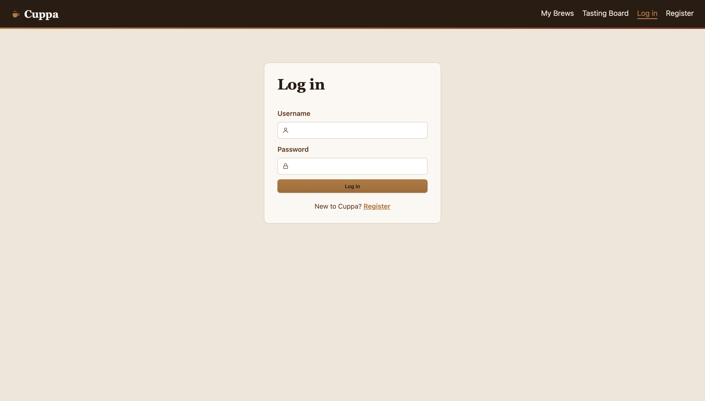
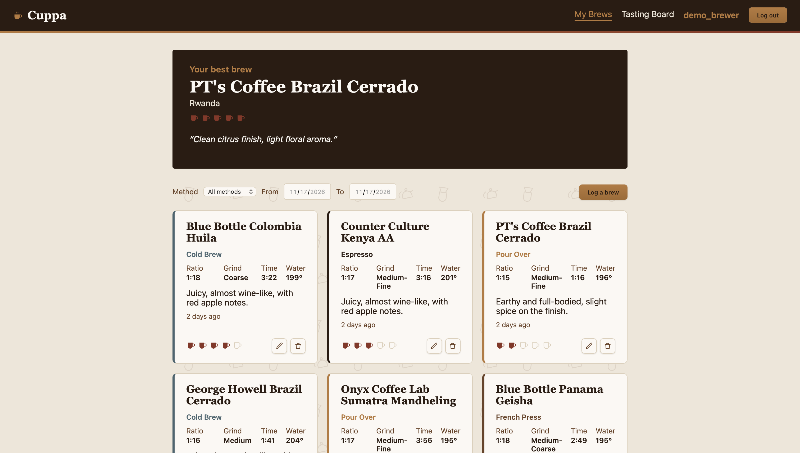

# Cuppa - Coffee Brew Log & Tasting Board

## Project Description

Brew it. Rate it. Find your next bag. Cuppa helps home brewers repeat their
best cup and find beans worth buying. It has two independent features: a
private **Brew Log** for your own brews and a public **Tasting Board** of
bean reviews.

## Author

- Sree Rachnae Shyam
- Sai Venkatesh Varun Muruganandam Murali Krishnan

## Class Link

[CS5610 Web Development, Fall 2026](https://johnguerra.co/classes/webDevelopment_online_fall_2026/)

## Live Website

Render deployment URL - https://cuppa-o57w.onrender.com

Demo logins (seeded data): `demo_brewer` / `demo12345` for the Brew Log,
`demo_taster1` to `demo_taster8` / `demo12345` for the Tasting Board.

## Video Demo

(add the video link here)

## Presentation Slides

(add the slides link here)

## Project Objective

Most people who brew coffee at home change the beans, grind, ratio and
water temperature without writing anything down, so a great cup is hard to
make again. Buying new beans is also a guess, because reviews are spread
across store pages and forums. Cuppa keeps both in one place for two kinds
of coffee drinkers:

- **Maya** brews at home and wants to repeat her best cup, so she keeps a
  private **Brew Log** of every brew and its rating (Rachna's feature).
- **Leo** wants honest reviews before buying beans, so he searches the
  public **Tasting Board**, filters reviews by roaster, origin and rating,
  and sees each coffee's average rating (Varun's feature).

## Screenshots

**Home**


**Log in**


**My Brews**


**Tasting Board**


## How to Use

1. Open the **Tasting Board** from the nav bar. Anyone can browse it
   without logging in.
2. Search by coffee, roaster or notes, and filter by roaster, origin or
   minimum rating. Each card shows the coffee's average rating across all
   reviews.
3. **Register** or **Log in** to write a review, or to open **My Brews**
   and log your own brews.
4. On **My Brews**, filter by method or date. The banner at the top shows
   your best-rated brew.
5. Your own reviews and brews show **edit** and **delete** buttons.

---

## Tech Stack

- **Frontend:** React 18 (with Hooks), built with Vite, React Router,
  PropTypes, Fetch API
- **Backend:** Node.js, Express (ES modules)
- **Authentication:** Passport (local strategy), `express-session`,
  sessions stored in MongoDB via `connect-mongo`, passwords hashed with
  `bcryptjs`
- **Database:** MongoDB, native Node.js driver (no Mongoose)
- **Deployment:** Render
- **Linting/Formatting:** ESLint + Prettier
- Separate `package.json` files for `backend/` and `frontend/`
- No Axios and no CORS package, since Express serves the built React app
  directly

---

## Features

### Brew Log (Rachna)

A private, per-user log of coffee brews. Only the logged-in user can see
or modify their own brews. This is enforced server-side on every route,
not just hidden in the UI.

- Create, edit, and delete brew entries: bean/roaster, origin, brew
  method, grind size, ratio, brew time, water temperature, rating (1-5),
  tasting notes, and date
- Filter the log by brew method and/or a date range
- A "Best Brew" banner automatically surfaces the single highest-rated
  entry, and updates immediately after any save or delete
- Ratings are shown and entered as coffee-cup icons rather than generic
  stars, with click-to-rate and hover preview in the logging form

### Tasting Board (Varun)

A public board of coffee bean reviews. Anyone can browse and filter it
without an account. Logging in lets you post reviews, and only a review's
author can edit or delete it (checked server-side, not just hidden in the
UI).

- Create, edit, and delete your own reviews: coffee name, roaster, origin,
  rating (1-5 coffee cups), and tasting notes
- Browse every review, newest first, and filter by roaster, origin
  (case-insensitive, partial match), and minimum rating
- Search box that matches the coffee name, roaster, or tasting notes, and
  combines with the filters
- The page shows the total number of reviews, or "Showing X of Y" while a
  search or filter is on
- Each review card shows that coffee's **average rating** and review count
  across all reviews of the same coffee from the same roaster, and it
  updates after any save or delete

---

## Folder Structure

```
/
├── README.md
├── Design.md
├── LICENSE
├── .prettierrc.json
│
├── backend/
│   ├── server.js
│   ├── package.json
│   ├── eslint.config.js
│   ├── auth/
│   │   └── passportConfig.js     - Passport local strategy
│   ├── db/                       - one file per collection, plus the shared connection
│   │   ├── connection.js
│   │   ├── users.js
│   │   ├── brews.js
│   │   └── tastings.js
│   ├── validation/               - one file per collection
│   │   ├── user.js
│   │   ├── brew.js
│   │   └── tasting.js
│   ├── routes/                   - one Express router per feature
│   │   ├── auth.js
│   │   ├── brews.js
│   │   └── tastings.js
│   └── scripts/                  - seed scripts (see below)
│       ├── seedBrews.js
│       └── seedTastings.js
│
└── frontend/
    ├── index.html
    ├── package.json
    ├── eslint.config.js
    ├── vite.config.js
    ├── public/                   - hero photo and background patterns
    └── src/
        ├── main.jsx
        ├── App.jsx
        ├── index.css             - color variables and shared base styles
        ├── components/           - each component with its own .css file
        │   ├── NavBar.jsx        - shared nav (used by both features)
        │   ├── AuthForm.jsx      - shared login/register form
        │   ├── ProtectedRoute.jsx - shared login-required route guard
        │   ├── ActionIcons.jsx   - edit and delete icons
        │   ├── CupRating.jsx     - coffee-cup rating, display or interactive
        │   ├── BestBrewBanner.jsx - the "best brew" display
        │   ├── BrewCard.jsx      - one logged brew, ticket-style
        │   ├── BrewFilterBar.jsx - method and date range filters
        │   ├── BrewForm.jsx      - create/edit brew form
        │   ├── TastingCard.jsx   - one review, with its coffee's average
        │   ├── TastingFilterBar.jsx - search, roaster, origin and rating filters
        │   └── TastingForm.jsx   - create/edit review form
        ├── constants/
        │   └── brewMethods.js    - method list and method-to-color mapping
        ├── context/
        │   └── AuthContext.jsx   - shared session state
        ├── utils/
        │   └── formatRelativeTime.js - "3 days ago" style dates
        └── pages/
            ├── HomePage.jsx
            ├── LoginPage.jsx
            ├── RegisterPage.jsx
            ├── BrewsPage.jsx     - the Brew Log page
            └── TastingsPage.jsx  - the Tasting Board page
```

---

## Setup / Instructions to Build

1. Clone the repo:
   ```
   git clone https://github.com/shyamrachna25/cuppa.git
   cd cuppa
   ```
2. Install and set up the backend:
   ```
   cd backend
   npm install
   ```
   Create a `.env` file in `backend/` (never committed):
   ```
   MONGODB_URI=mongodb+srv://<user>:<password>@<cluster>/cuppa?retryWrites=true&w=majority
   SESSION_SECRET=<any long random string>
   ```
   Run it:
   ```
   node --env-file=.env server.js
   ```
3. In a second terminal, install and run the frontend:
   ```
   cd frontend
   npm install
   npm run dev
   ```
4. Open `http://localhost:5173`. Vite proxies `/api` requests to the
   backend on port 3000 during local development.

### Production build (how it runs on Render)

Express serves the built React app from `frontend/dist`, so there is one
server and no CORS:

```
cd frontend && npm install && npm run build
cd ../backend && npm install && node --env-file=.env server.js
```

Then open `http://localhost:3000`. On Render (Web Service, repo root):

- **Build command:** `cd frontend && npm install && npm run build && cd ../backend && npm install`
- **Start command:** `cd backend && npm start`
- **Environment variables:** `MONGODB_URI` and `SESSION_SECRET`, set in
  the Render dashboard, never committed

> Note: the `npm start` script (`node server.js`) does **not** include the
> `--env-file` flag, since Render injects the environment variables
> directly. When running locally, use `node --env-file=.env server.js`.

### Lint and format

```
cd backend  && npm run lint && npm run format
cd frontend && npm run lint && npm run format
```

ESLint configs live in each folder (`eslint.config.js`), and the shared
Prettier config is `.prettierrc.json` at the repo root.

---

## Authentication

Passport local strategy with sessions stored in MongoDB (`connect-mongo`),
so logins persist across server restarts and page refreshes. Passwords
are hashed with `bcryptjs`, so plain text passwords are never stored.

Every authenticated request has `req.user` available server-side
(`req.user._id`, `req.user.username`).

---

## Seed Scripts

Two scripts populate the database with synthetic data. Each is safe to
re-run, since it only clears and replaces its own demo data.

### `scripts/seedBrews.js`

Seeds **1,200 brews** for the demo account `demo_brewer` / `demo12345`,
creating the account if it doesn't exist. It only ever replaces the demo
account's own brews, never any other user's real data. Run with:

```
cd backend
node --env-file=.env scripts/seedBrews.js [count]
```

### `scripts/seedTastings.js`

Seeds **1,200 reviews** spread across 8 demo accounts (`demo_taster1` to
`demo_taster8` / `demo12345`), 12 coffees and 8 roasters, creating the
accounts if they don't exist. It only replaces reviews written by the demo
accounts, never real users' reviews. Run with:

```
cd backend
node --env-file=.env scripts/seedTastings.js [count]
```

Both scripts default to 1,200 records. Pass a smaller `count` while
testing.

---

## Data Model

```text
brews collection
  _id
  userId      string form of the owning user's ObjectId
  beanName    required
  origin      optional
  method      Pour Over, French Press, Espresso, AeroPress, Cold Brew, Other
  grindSize
  ratio       e.g. "1:16"
  brewTime    e.g. "3:30"
  waterTemp   number, °F
  rating      1-5, required
  notes
  date        required
  createdAt
```

```text
tastings collection
  _id
  userId       string form of the author's ObjectId (set by the server)
  username     author's username, shown on the card (set by the server)
  coffeeName   required
  roaster      required
  origin       optional
  rating       whole number 1-5, required
  notes        optional
  createdAt
```

The tastings server only saves the fields above, so a client cannot set
`userId` or `username` itself.

---

## API Endpoints

| Method | Endpoint                                       | Login | Description                                          |
| ------ | ---------------------------------------------- | ----- | ---------------------------------------------------- |
| POST   | `/api/auth/register`                           | No    | Create an account, logs in immediately               |
| POST   | `/api/auth/login`                              | No    | Log in                                               |
| POST   | `/api/auth/logout`                             | No    | Log out                                              |
| GET    | `/api/auth/session`                            | No    | Check whether the current session is logged in       |
| GET    | `/api/brews?method=&start=&end=`               | Yes   | List the logged-in user's brews, optionally filtered |
| GET    | `/api/brews/best`                              | Yes   | The logged-in user's single highest-rated brew       |
| POST   | `/api/brews`                                   | Yes   | Create a brew                                        |
| PUT    | `/api/brews/:id`                               | Yes   | Update a brew (only if you own it)                   |
| DELETE | `/api/brews/:id`                               | Yes   | Delete a brew (only if you own it)                   |
| GET    | `/api/tastings?q=&roaster=&origin=&minRating=` | No    | List reviews, optionally searched and filtered       |
| GET    | `/api/tastings/averages`                       | No    | Average rating and count per coffee + roaster        |
| POST   | `/api/tastings`                                | Yes   | Post a review                                        |
| PUT    | `/api/tastings/:id`                            | Yes   | Edit a review (author only, otherwise 404)           |
| DELETE | `/api/tastings/:id`                            | Yes   | Delete a review (author only, otherwise 404)         |
| GET    | `/api/health`                                  | No    | Health check                                         |

---

## Use of GenAI Tools

We used Claude (Anthropic) for coding assistance, debugging, planning, and design guidance throughout this project, the Express fallback route for deployment, API testing, and writing this README and the design document.

Model Used:
Claude (Anthropic), Chatgpt -5.6 Luna

Example Prompts used:
"Check if these files from my partner are ok to merge with our code." 
"Help me check if my code satisifies the rubric of the project." "Help me write a Readme for my project."

What was not AI assisted:
Core app architecture, MongoDB collection design, Tasting Board and Brew Log features, coffee-cup rating UI, color palette and CSS design, and Render deployment.


The final website content and design were reviewed and customized by us.

---

## Code Review

This project includes the required files and is prepared for code review
as part of the course submission.

## License

MIT - see [LICENSE](./LICENSE)
